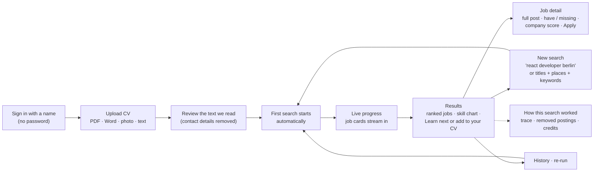
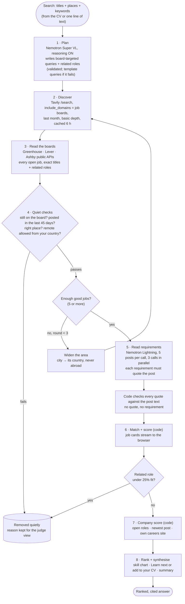
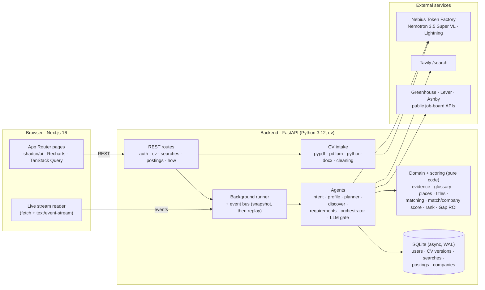

# Postulo

> **Open, recent jobs that fit your CV. Every skill tag is backed by a quote, every score is computed by code, and dead or fake postings never reach you.**

Postulo is a **deep research agent for job seekers**. You upload a CV and Postulo researches the live web the way a careful recruiter would: it plans its searches, finds company job boards with **Tavily**, reads the boards directly, throws out closed, old and wrong-place postings, searches again when results are thin, and turns what it found into a short, ranked, cited answer. **NVIDIA Nemotron on Nebius Token Factory** plans and reads; plain code checks every claim and computes every number.

| | |
|---|---|
| **Track** | Agentic Deep Research with Token Factory and Tavily (main) · Nemotron Agentic AI (subtrack) |
| **Models** | `nvidia/Nemotron-3.5-Super-VL` (planning, CV reading, vision OCR) · `nvidia/Nemotron-3_5-Lightning` (requirements, open search), both on Nebius Token Factory |
| **Search** | Tavily `/search` (our own research loop, not `/research`) + Greenhouse, Lever and Ashby public job-board APIs |
| **Built** | In one day at The Delta Campus hackathon (hosted by Nebius) |

---

## For judges: the 60-second version

| Judging criterion | What to look at |
|---|---|
| **Technical execution (50%)** | A real multi-step agent on live data: plan → Tavily → board APIs → quiet checks → widen and search again → Nemotron extraction → code-verified quotes → code-computed scores → streamed results. A full backend test suite (no network needed), ruff + mypy clean, typed frontend, Docker, deployed on Nebius Serverless AI. It keeps working when Nemotron is down. |
| **Creativity and wow (30%)** | **Ghost jobs vanish:** closed, stale, wrong-country postings are removed before you see them, and the "How this search worked" page shows each one with the reason. **Proof on every chip:** hover a skill and see the exact sentence from the job post and from your CV. **One-line search:** type `Sr. ML Eng remote` and it becomes *Senior Machine Learning Engineer · Remote*. **"Learn next or add to your CV":** the one skill that would lift the most of your matches. |
| **Fit to the challenge (20%)** | Token Factory serves every model call and Tavily does every web search. The research loop is ours (sub-queries, read, check, find gaps, search again, synthesise). Every claim cites its source. Progress streams live. |

**Pitch line:** *Job boards show you jobs. Postulo tells you which ones are real, why you fit, and what's missing, with proof.*

---

## The problem

- **Ghost jobs.** Many listings are closed, months old or reposted. You can't tell from the listing.
- **Black-box matching.** "Top applicant" badges never say *why*. Applicants guess what's missing.
- **Too narrow, too wide.** Searching "AI Engineer" misses "ML Engineer" and "LLM Engineer"; searching broadly floods you with jobs you can't take (wrong country, "remote, US only").
- **LLMs make it worse if trusted blindly.** A model will happily invent a requirement, a date or a score.

## What Postulo does

1. **Reads your CV**, whatever the format: PDF (best of three extractors, column-aware), Word, pasted text, or a photo/scan (Nemotron Super VL vision, about 1.7 s per page). You review the text before anything happens. Email, phone, birth date and profile links are removed before saving.
2. **Builds a structured profile** (roles, years, skills, languages, education). Each item must quote your CV, or it is dropped.
3. **Runs your first search automatically**, from your CV: the job titles you held, related roles (an "AI Engineer" also sees "ML Engineer", "LLM Engineer"…), your city, or anywhere.
4. **Shows 5–10 open, recent jobs** ranked by an honest **match score**, each skill tagged *you have it* / *close match* / *nice-to-have gap* / *must-have gap*, with a quote for every tag.
5. **Explains the company** with a separate **company score**: how actively it is hiring (open roles, newest post, own careers site). It is not your fit; that's the match %.
6. **Tells you what to do next**: a skill chart across the jobs and **"Learn next or add to your CV"**, the missing skills that would lift the most jobs. Often you already have one and just didn't write it down.
7. **Job detail**: the full post with your skills highlighted, the match breakdown, the company facts and a direct **Apply on company site** link.
8. **Search again any time**: one line of free text, or titles + places + keywords. History and one-click re-run included.

---

## User flow



Every screen is safe to reload: results are saved as they arrive and the live stream replays from a snapshot.

---

## Agent flow: the research loop

This is our own loop. Tavily is a tool the agent calls, not the agent.



| Step | Who does it | Model / tool | Fallback if it fails |
|---|---|---|---|
| Open search ("Sr. ML Eng remote") | `agents/intent.py` | Nemotron Lightning | Rule parser (titles, places, skills from the glossary) |
| CV reading (scans, photos, broken PDFs) | `services/intake/ocr.py` | Nemotron Super VL vision | Text extractors (pypdf layout, pdfium, pypdf) |
| Profile | `agents/profile.py` | Nemotron Super VL, reasoning off | Rule-based extraction with the skill glossary |
| Plan | `agents/planner.py` | Nemotron Super VL, **reasoning on** | Template queries |
| Discover | `agents/discover.py` | Tavily `/search` | Cached results; boards already known |
| Read boards + quiet checks | `services/ats.py`, `agents/discover.py` | Greenhouse, Lever, Ashby APIs | A board that can't be read is skipped and logged |
| Requirements | `agents/requirements.py` | Nemotron Lightning, reasoning off | Rule-based extraction (same quote check) |
| Match, company score, rank, Gap ROI | `domain/`, `scoring/` | **Code only** | n/a: deterministic |

The orchestrator (`agents/orchestrator.py`) runs these steps as a state machine in a background task. Every step writes to an event bus that the browser reads live.

---

## Grounding: the LLM proposes, code verifies

- **No invented requirements:** a requirement without a quote that appears in the job post is dropped. The same rule applies to the CV profile.
- **No invented numbers:** match score, company score, ranking and Gap ROI are fixed formulas in `scoring/`, pinned by golden tests. The same requirements always give the same scores.
- **No invented freshness:** dates and "still open" come from the job board's own API, not from the model.
- **Prompt-injection safe by design:** CVs and posts are passed as data inside tags, prompts say so, and nothing the model returns can trigger an action.
- **Fair by design:** the profile never stores name, age, birth date, gender, nationality, marital status, photo, health or religion. The vision step never describes photos or faces. None of it can affect a score.

---

## Architecture



**Deploy:** one Nebius Serverless AI endpoint runs the app from a single image, with nginx giving one HTTPS origin (`/api` → backend, everything else → frontend). See [Deploy on Nebius](#deploy-on-nebius).

---

## Scoring

**Match score (0–100), `scoring/match_score.py`**

- Scored requirements: tech, soft, domain and language. Must-have weighs 3, nice-to-have 1, soft skills always count as nice-to-have.
- Credit: *have* = 1, *close match* = 0.5, *missing* = 0. Score = weighted credit ÷ total weight × 100.
- Caps: a required language you don't have caps the score at 50; required years far above yours (more than +2) cap it at 60. The card says which cap applied.
- Fewer than 3 requirements found = "thin" posting, ranked last.

**Ranking, `scoring/rank.py`:** thin postings last, then match score, then postings with a known date, then newest first. A toggle sorts by company score instead.

**Company score (0–100), `scoring/company_score.py`.** It measures how actively the company is hiring, not your fit.

| Signal | Points |
|---|---|
| Open roles on their job board | up to 30 (50+ roles gets all 30) |
| How new the latest job post is | up to 20 (this week gets 20, over 3 months gets 0) |
| Careers site on their own domain | up to 20 (without it, the first two are scaled to 100) |

Strong is 70+, Okay 40–69, Weak under 40. A board we can't read shows "Not enough data", never a guess. The badge tooltip and the job page explain this in plain words.

**Skill chart and "Learn next or add to your CV", `scoring/summary.py`:** for every missing tech, domain or language skill, the code re-scores all jobs as if you had it, and shows the top 3 by jobs improved and points gained ("+5.3 points on 3 jobs · fixes a must-have in 3"). Languages are marked "takes longer". No LLM call.

---

## How it meets the track briefs

**Agentic Deep Research with Token Factory and Tavily**

| Brief asks for | Postulo |
|---|---|
| Token Factory serves the model, Tavily provides search | ✅ Every LLM call goes to Nebius Token Factory; every web search goes to Tavily `/search` |
| Your own research loop, not just Tavily `/research` | ✅ Plan sub-queries → search → read the boards → check → find gaps → search again → synthesise |
| Iterative depth: the agent decides it needs more | ✅ Under 5 good jobs, it widens the area and searches again (max 3 rounds), and tells you so |
| Citations for every claim | ✅ Each requirement quotes the post, each "you have it" quotes your CV, each company fact links its source, each job links the original post |
| A clear final answer | ✅ Ranked jobs, match breakdown, skill chart, "Learn next or add to your CV", a plain summary of what was searched |
| Source quality: dedupe, rank, authoritative domains | ✅ `include_domains` limits Tavily to job-board domains; boards are deduped and the ones mentioning your place go first; postings come from the company's own board, not aggregators |
| Stream progress live | ✅ Stages and job cards stream as they're ready |

**Nemotron Agentic AI (subtrack)**

| Brief asks for | Postulo |
|---|---|
| Nemotron as the core model | ✅ Super VL for planning, CV reading and vision; Lightning for high-volume extraction and parsing |
| A real task with a start and a finish | ✅ From a CV to a ranked, cited shortlist with apply links |
| Multi-step, several tools | ✅ Tavily, three job-board APIs, PDF/Word/vision readers, glossary, scoring, the database |
| Show the trace | ✅ Live progress, plus "How this search worked": each agent step, every removed posting with its reason, Tavily credits and Nemotron calls used |
| Error recovery | ✅ Every LLM call goes through `llm_gate.py`: on timeout, budget exhaustion (402) or bad JSON, grounded rules take over and the user is told. Unreadable boards and oversized boards (6 MB / 20 s caps) are skipped, not fatal |
| Use Nemotron features | ✅ Reasoning **on** for planning, **off** for fast steps; **vision** input for scans and photos; a **Lightning sub-agent** for cheap steps |

---

## Measured on real data

All runs below used live Tavily, live job boards and Nemotron on Token Factory.

| Run | Result |
|---|---|
| Team CV PDF (two columns) | Read as 68 clean lines; the naive extractor gave 1,147 broken lines |
| Scanned page through Nemotron Super VL vision | ~1.7 s per page |
| "Data Engineer, Berlin" (first search) | 30–40 s end to end, 6–12 Tavily credits, 3 Nemotron calls; removed closed jobs, a 111-day-old post and a Warsaw job |
| "AI Engineer, Remote" (re-run) | 29 s, 5 jobs (Germany, UK, Remote); US-only remote jobs removed for a Berlin profile |
| Anywhere search | 26 s, 1 Tavily credit, jobs across several countries |
| Open search `REACT developer in München, Node JS` | React Developer · Munich · Node.js |

---

## Reliability, cost, privacy

**Reliability**
- Nemotron unavailable? Rule-based extraction with the same quote checks takes over; the app always returns an answer and says it used rules.
- Missing API keys return HTTP 503 with a clear error, never a crash. `MOCK_MODE=true` runs the full pipeline on fake Tavily and fake boards over a real database.
- Searches interrupted by a restart are marked failed on startup; results saved so far stay.

**Cost control**
- Budgets per search: 20 Tavily credits and 15 Nemotron calls (both configurable). Typical: 1–12 credits, about 3 calls.
- Tavily results cached for 6 hours; job requirements cached by post text hash and extraction version, so a re-run costs almost nothing.
- Basic search depth only (1 credit); big boards are read through light list endpoints.

**Privacy**
- Name-only sign-in, no email or password stored. The app tells you that anyone who knows your name can open the account.
- Contact details and profile links are stripped from the CV before saving. Protected attributes are never stored or scored.
- "Delete my data" in Settings removes the account, CVs and searches. No database file is in git.

---

## Try it

### The 3-minute judge path

1. Sign in with any name.
2. Upload [docs/samples/alex_cv.pdf](docs/samples/alex_cv.pdf) (or `alex_cv.docx`) and confirm the text.
3. Watch the first search run: stages, then job cards streaming in.
4. Hover a **skill chip** (quote from the post and from the CV) and the **Company** badge (what the score means).
5. Open a job: full post with highlights, match breakdown, company facts, **Apply on company site**.
6. Click **New search** and type `react developer berlin` or `Sr. ML Eng remote`.
7. At the bottom of the results, open **How this search worked**: agent trace, removed postings with reasons, credits used.

### Quick start

**Docker**

```bash
cp .env.example .env            # PowerShell: Copy-Item .env.example .env
docker compose up --build
```

UI: http://localhost:3000 · API docs: http://localhost:8000/docs

**Local dev** (needs [uv](https://docs.astral.sh/uv/getting-started/installation/) 0.10+ and Node.js 22+)

```bash
npm run setup                   # creates .env, runs uv sync + npm install
npm run dev:backend             # http://localhost:8000
npm run dev:frontend            # http://localhost:3000 (second terminal)
```

On Windows, `powershell -ExecutionPolicy Bypass -File scripts\dev.ps1` opens both servers. With `make`: `make setup`, then `make dev`.

**Real searches:** in `.env`, set `MOCK_MODE=false` and fill in `NEBIUS_API_KEY` and `TAVILY_API_KEY`. List the Nemotron IDs your key can use with `cd backend && uv run python scripts/list_models.py`.

### Deploy on Nebius

One **Nebius Serverless AI endpoint** runs the whole app from one image: nginx on `:8080` sends `/api`, `/health` and `/docs` to FastAPI and everything else to Next.js, behind one managed HTTPS URL. Nemotron stays on Token Factory.

**You need:** the [Nebius CLI](https://docs.nebius.com/cli/install) (logged in), Docker Desktop, `jq`, and a bash shell (macOS, Linux, WSL or Git Bash).

1. **App secrets**, in the repo-root `.env`: `NEBIUS_API_KEY`, `TAVILY_API_KEY` and `MOCK_MODE=false`. The deploy script reads them from there and never prints them.
2. **Deploy settings** (optional; the defaults work): `cp deploy/nebius/.env.nebius.example deploy/nebius/.env.nebius` and set `PROJECT_ID` if your CLI has no default project. All settings and their defaults are in [.env.nebius.example](deploy/nebius/.env.nebius.example).
3. **Build and push the image, then create the endpoint:**

   ```bash
   ./deploy/nebius/build-push.sh       # or: make nebius-build
   ./deploy/nebius/deploy-endpoint.sh  # or: make nebius-endpoint
   ```

   The second script waits until the endpoint is running and prints the URL (UI at `/`, API docs at `/docs`).

**Update:** run both scripts again (the endpoint is replaced, which also clears its SQLite data). **Logs:** `nebius ai endpoint logs "$(cat deploy/nebius/.state/endpoint_id)"`. **Remove:** `./deploy/nebius/destroy-endpoint.sh` (or `make nebius-endpoint-destroy`). More notes: [deploy/nebius/README.md](deploy/nebius/README.md).

---

## Reference

### Tech stack

| Layer | Tech |
|---|---|
| Models | **NVIDIA Nemotron 3.5** Super VL + Lightning on **Nebius Token Factory** (OpenAI-compatible, `openai` SDK, reasoning via `chat_template_kwargs`) |
| Web data | **Tavily** `/search` (raw API for `include_published_date` and usage counts) + Greenhouse, Lever, Ashby public APIs |
| Backend | Python 3.12, FastAPI, Pydantic v2, SQLAlchemy 2 (async, SQLite), pypdf, pypdfium2, Pillow, python-docx, httpx, **uv** |
| Frontend | Next.js 16 (App Router, Cache Components), React 19, Tailwind CSS 4, shadcn/ui (Radix), Recharts, lucide-react, TanStack Query, sonner |
| Ops | Docker (non-root, healthchecks, data volume), docker compose, Nebius Serverless AI (nginx) |

### Environment variables

All variables live in `.env` at the repo root (see [.env.example](.env.example)).

| Variable | Default | Purpose |
|---|---|---|
| `MOCK_MODE` | `true` in `.env.example` (the code defaults to `false`) | Fake Tavily and boards, no API calls |
| `NEBIUS_API_KEY` | — | Token Factory API key |
| `NEBIUS_BASE_URL` | `https://api.tokenfactory.nebius.com/v1/` | OpenAI-compatible base URL |
| `NEMOTRON_MODEL` | `nvidia/Nemotron-3.5-Super-VL` | Main model (planning, CV profile) |
| `NEMOTRON_FAST_MODEL` | `nvidia/Nemotron-3_5-Lightning` | Fast model (requirements, open search) |
| `NEMOTRON_VISION_MODEL` | `nvidia/Nemotron-3.5-Super-VL` | Reads scans, photos and broken PDFs |
| `OCR_ENABLED` | `true` | Use Nemotron vision for CV images and scans |
| `TAVILY_API_KEY` | — | Tavily search key (`tvly-...`) |
| `LLM_TIMEOUT_SECONDS` | `120` | Timeout per Nebius call |
| `LLM_MAX_TOKENS` | `8000` | Max tokens per Nebius call (reasoning tokens count) |
| `MAX_POSTINGS` | `10` | Postings returned per search (1–20) |
| `MAX_TAVILY_CREDITS_PER_RUN` | `20` | Tavily credit budget per search |
| `MAX_LLM_CALLS_PER_RUN` | `15` | Nemotron call budget per search (rules take over after) |
| `RECENT_DAYS` | `45` | Older postings are removed quietly |
| `DATABASE_URL` | `sqlite+aiosqlite:///./data/postulo.db` | SQLite file; the folder is created on startup |
| `CORS_ORIGINS` | `http://localhost:3000` | Comma-separated allowed frontend origins |
| `LOG_LEVEL` | `INFO` | `DEBUG`, `INFO`, `WARNING` or `ERROR` |
| `NEXT_PUBLIC_API_URL` | `http://localhost:8000` | Backend URL as seen from the browser, inlined at frontend build time |

### API

All `/api/*` routes except `/api/auth/login` and `/api/places` need `Authorization: Bearer <token>`. Full shapes: http://localhost:8000/docs and [docs/PHASE1_PLAN.md](docs/PHASE1_PLAN.md) §5.4.

| Method | Path | Purpose |
|---|---|---|
| `GET` | `/health` | Status, mock mode, keys configured, model IDs |
| `POST` | `/api/auth/login` · `/api/auth/logout` | Name-only login, token |
| `GET` / `PUT` / `DELETE` | `/api/me`, `/api/me/settings` | Current user, search defaults, delete my data |
| `GET` | `/api/places?q=` | Places (city, country, region, Remote); any typed place is accepted |
| `POST` / `PUT` / `GET` / `DELETE` | `/api/cv`, `/api/cv/{id}` | Upload or paste, review and confirm, list, one version with its profile, delete |
| `POST` / `GET` | `/api/searches`, `/api/searches/{id}` | Start a search (titles, optional places and keywords), history, detail |
| `POST` | `/api/searches/parse` | Free text → titles, places, keywords |
| `GET` | `/api/searches/{id}/events` | Live stream (`text/event-stream`, snapshot first) |
| `POST` | `/api/searches/{id}/rerun` | Same inputs, fresh checks |
| `GET` | `/api/postings/{id}?search_id=` | Job detail: full post, apply link, match breakdown, company score |
| `GET` | `/api/how/{search_id}` | Judge view: agent trace, removed postings, credits used |

### Project structure

```
postulo/
├── backend/app/
│   ├── main.py, config.py, errors.py, events.py (stream bus), runner.py (background searches)
│   ├── api/                 deps.py (auth, DB), presenters.py (rows -> API), routes/
│   ├── agents/              orchestrator, intent, planner, discover, requirements, profile,
│   │                        llm_gate, prompts/ (all prompts live here)
│   ├── domain/              pure logic: normalize, evidence, glossary (+ data/glossary.json),
│   │                        places, remote, titles, years, rules, matching
│   ├── scoring/             match_score, company_score, rank, summary (skill chart + Gap ROI)
│   ├── services/            llm.py, tavily_client.py, ats.py (Greenhouse/Lever/Ashby),
│   │                        intake/ (PDF, docx, OCR, cleaning), fakes.py (mock mode)
│   ├── schemas/             API shapes (frontend/src/lib/types.ts mirrors them)
│   └── db/                  engine.py (SQLite, WAL), tables.py, repos/
├── frontend/src/
│   ├── app/                 login, (app)/onboarding, profile, search/[id], search/[id]/job/[postingId],
│   │                        new-search, history, settings, how/[id]
│   ├── features/            auth, cv, search, results, job, shell
│   ├── components/ui/       shadcn/ui (Radix)
│   └── lib/                 api/, sse.ts, types.ts, status.ts, company.ts, format.ts
├── deploy/nebius/           Serverless AI deploy: build-push, deploy/destroy endpoint,
│                            serverless/ (all-in-one image, nginx), .env.nebius.example
└── docs/                    PHASE1_PLAN.md, PHASE2_PLAN.md (plans + decision log), samples/
```

### Quality

| Check | Command |
|---|---|
| Backend tests (no network or keys needed) | `cd backend && uv run pytest` |
| Backend lint + types | `uv run ruff check . && uv run ruff format --check . && uv run mypy app` |
| Frontend lint + types + build | `cd frontend && npm run lint && npm run typecheck && npm run build` |
| Everything (Windows) | `scripts\check.ps1` |

The scoring formulas have golden tests; domain logic (places, titles, glossary, remote rules, quote checks) is unit-tested without I/O; API tests run the whole pipeline in mock mode.

---

## What's next

- More job sources: one parser in `services/ats.py` plus its domain in `ATS_DOMAINS` (Workday, Personio…).
- Company news from Tavily `topic=news`, each article with a quote and link.
- An advisor step: tailored CV bullets and a cover-letter draft per job, using the same quotes.

---

## Docs

- [docs/PHASE1_PLAN.md](docs/PHASE1_PLAN.md): the plan, decisions D1–D18, scoring formulas.
- [docs/PHASE2_PLAN.md](docs/PHASE2_PLAN.md): Phase 2 fixes and decisions D19–D30 (they win where they differ).
- [deploy/nebius/README.md](deploy/nebius/README.md): deploy the app on one Nebius Serverless AI endpoint.

## License

[MIT](LICENSE)
